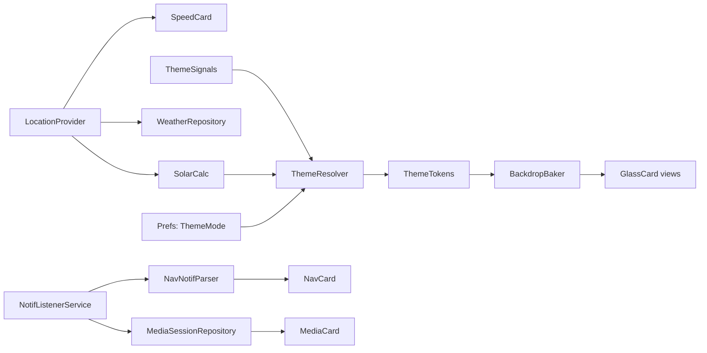
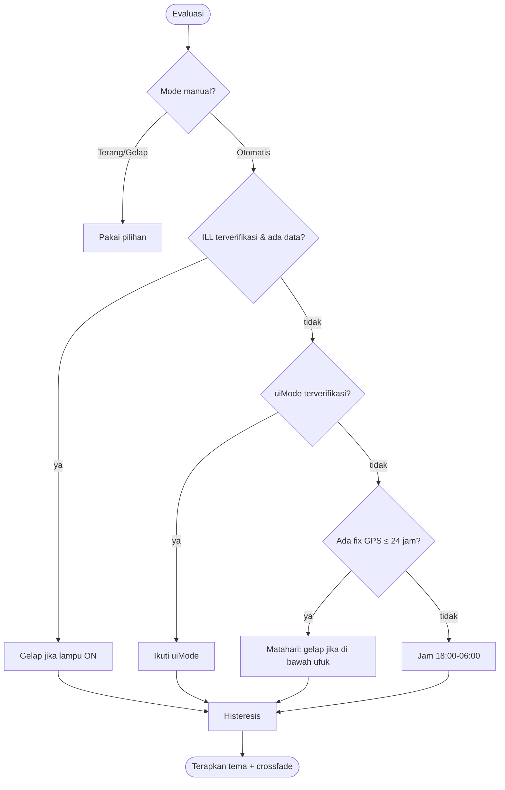

# TIP-02 — Custom Launcher "Haraya Dock" (Liquid Glass + Auto Dark/Light)

> **TIP** = Technical Implementation Plan. Dokumen ini dikerjakan **hari ini (2026-11-02)**.
> Pasangannya: [TIP-01-debloat.md](TIP-01-debloat.md) (dikerjakan nanti).
> Status dokumen: **DRAFT v1**. Belum ada kode. Semua klaim diberi label di bagian 1.

---

## 0. Cara membaca & aturan anti-salah

Setiap klaim di dokumen ini punya salah satu label:

| Label | Arti | Boleh dipakai sebagai dasar keputusan? |
|---|---|---|
| ✅ **V** (verified) | Sudah dicek langsung dari sumber (repo/API/mesin ini) pada 2026-11-02. Sumber disebut. | Ya |
| ⚠️ **U** (unverified) | Dari pengetahuan umum / belum dicek. Wajib punya langkah verifikasi (ID `A-xx`). | **Tidak**, sampai gate-nya lulus |
| 🔶 **D** (decision) | Keputusan desain. Ada alasan + opsi lain. Bisa diubah di Gate G-1. | Ya, sampai diubah |

**Aturan keras:**
1. **Tidak ada "selesai" tanpa bukti.** Tiap task selesai = perintah dijalankan + hasil sesuai ekspektasi + bukti tersimpan di `docs/evidence/<gate>/`.
2. **Tidak ada asumsi tentang head unit.** Semua fakta perangkat berasal dari Gate G0 (hasil `adb`), bukan dari repo referensi (yang dibuat untuk perangkat lain).
3. **Launcher bawaan tidak disentuh** sampai Gate G6 lulus, dan jalur pemulihan sudah *dilatih* sebelum launcher dijadikan default.
4. **Satu perubahan per verifikasi.** Jangan gabungkan banyak perubahan lalu menguji sekaligus.
5. **Kalau hasil verifikasi berbeda dari ekspektasi:** berhenti, catat di `docs/DECISIONS.md`, perbaiki rencana — jangan "disesuaikan" diam-diam.

---

## 1. Fakta yang sudah diverifikasi

### 1.1 Repo referensi (dicek 2026-11-02 via GitHub API/raw)

| Fakta | `agungpmbd/goldendash` | `hafiz-ridha/headunit-fortuner` |
|---|---|---|
| Lisensi | ✅ **MIT** (file `LICENSE` ada) | ✅ **Tidak ada file LICENSE** (HTTP 404) |
| Implikasi hukum | Boleh dipakai/dimodifikasi dengan atribusi | Secara default **all rights reserved**. **Jangan salin kode/aset.** Fitur (ide) boleh ditiru, implementasi harus tulis sendiri |
| Bahasa/build | Java murni, tanpa library, tanpa Gradle (`aapt2 → javac → d8 → zipalign → apksigner`) | Java, tanpa Gradle (`build.sh`) |
| minSdk / targetSdk | ✅ 24 / 29 (dari `build.sh`) | README: diuji Android 10 |
| Target perangkat | NWD K2401, 1280×720 | TS10 / Unisoc UMS512, Android 10, 1280×720 |
| Tema | ✅ `LIGHT / DARK / AUTO`; AUTO = **gelap jam 18:00–06:00 (jam tetap, bukan matahari)**; ganti tema = bangun ulang view | Hanya gelap |
| Background | `SilkBackground.java` — digambar sekali (hemat CPU) | — |
| Izin | ✅ FINE/COARSE_LOCATION, INTERNET, ACCESS_NETWORK_STATE, BLUETOOTH, WRITE_SETTINGS | Jauh lebih banyak (SYSTEM_ALERT_WINDOW, WRITE_SECURE_SETTINGS, PACKAGE_USAGE_STATS, BOOT_COMPLETED, dll.) |
| Navigasi | `NotifListener` membaca notifikasi Maps/Waze/Sygic/OsmAnd + `LiveMap` (tile OSM) | `NavNotificationListener` + PiP Google Maps lewat ADB lokal (rapuh) |
| Media | `Media.java`, `MediaCard.java` (sesi media apa pun) | Tidak relevan |
| Manifest HOME | ✅ activity `singleTask`, `clearTaskOnLaunch`, `configChanges` mencakup `uiMode` | sama |
| Fitur khusus | — | Al-Qur'an offline, doa naik kendaraan, mobil 360° (72 render), dock aplikasi TW |
| Catatan penting | — | ✅ Port ADB 5555 **tertutup lagi setelah restart penuh** headunit (dari `docs/TUTORIAL.md`) → jalur pemulihan harus dipikirkan |

Sumber: `https://github.com/agungpmbd/goldendash`, `https://github.com/hafiz-ridha/headunit-fortuner`.

### 1.2 Mesin pengembangan ini (dicek 2026-11-02)

| Item | Status |
|---|---|
| Mac | ✅ arm64 (Apple Silicon) |
| `adb` | ✅ ada (`/opt/homebrew/bin/adb`, v1.0.41). Belum ada device terhubung |
| Android SDK (`ANDROID_HOME`, build-tools, platforms) | ❌ **Tidak ada** |
| `sdkmanager`, `avdmanager`, `emulator`, `apksigner` | ❌ Tidak ada |
| Java | ❌ Hanya **JRE 8** (plugin browser). **Tidak ada JDK 17** → belum bisa build |
| Node.js 24 (untuk REA) | ✅ terpasang di sesi sebelumnya |

→ **Milestone M0 wajib menyiapkan toolchain dulu.** Ini bukan opsional.

---

## 2. Tujuan, non-tujuan, kebutuhan

### 2.1 Tujuan
Launcher Android head unit yang (a) ringan, (b) bergaya **Apple Liquid Glass**, (c) **Auto Dark/Light** yang andal, (d) fitur dasar setara referensi: jam, cuaca, speedometer GPS, info belokan, kartu media, pintasan, semua aplikasi, slider volume & kecerahan.

### 2.2 Non-tujuan v1
Al-Qur'an/doa, model mobil 360°, PiP Google Maps via ADB lokal, kontrol CANBUS/AC, akun/cloud/telemetri, Play Store.

### 2.3 Kebutuhan (traceability — dipakai di bagian 9)

| ID | Kebutuhan | Prioritas |
|---|---|---|
| R-01 | Terdaftar sebagai HOME; bisa dipilih jadi default; launcher bawaan tetap utuh & bisa dikembalikan | Must |
| R-02 | Home menampilkan jam/tanggal (locale `id`), cuaca, kecepatan GPS, info belokan, kartu media, pintasan, slider volume & kecerahan | Must |
| R-03 | Layar Semua Aplikasi: grid, pencarian, sembunyikan aplikasi, urut | Should |
| R-04 | Tema `Terang / Gelap / Otomatis`; Otomatis memakai sumber berurutan (bagian 5.3); ganti **tanpa restart**, **tanpa flicker** | Must |
| R-05 | Bahasa visual Liquid Glass di kedua tema; teks lolos kontras WCAG AA | Must |
| R-06 | Layout benar di 1280×720, 1024×600, 1920×1080 | Must |
| R-07 | Anggaran performa (bagian 9.4) terpenuhi di perangkat asli | Must |
| R-08 | Aman: tidak crash-loop, ada jalur pemulihan, tanpa telemetri, izin minimal | Must |
| R-09 | Launcher tidak bergantung pada paket yang mungkin dihapus di TIP-01 | Must |

---

## 3. Gate G0 — Fakta perangkat (WAJIB sebelum desain final)

Semua langkah di bagian ini **read-only** (tidak mengubah headunit). Aman dijalankan hari ini. Simpan output mentah ke `docs/evidence/G0/`.

### 3.1 Perintah

```bash
mkdir -p docs/evidence/G0 && cd docs/evidence/G0
adb devices -l                                            | tee devices.txt
adb shell getprop                                         > getprop.txt
adb shell getprop ro.build.version.sdk                    # → API level (menentukan teknik blur)
adb shell getprop ro.product.model
adb shell getprop ro.board.platform
adb shell wm size                                         # resolusi fisik
adb shell wm density                                      # dpi → hitung viewport dp
adb shell pm list packages -f -u                          > packages_all.txt
adb shell pm list packages -3                             > packages_3rdparty.txt
adb shell cmd package resolve-activity -a android.intent.action.MAIN -c android.intent.category.HOME  > home_resolve.txt
adb shell dumpsys package | grep -A3 "android.intent.category.HOME" > home_candidates.txt
adb shell dumpsys location | head -n 120                  > location.txt
adb shell dumpsys media_session                           > media_session.txt
adb shell dumpsys notification --noredact | head -n 80    > notif.txt
adb shell settings list secure                            > settings_secure.txt
adb shell settings list system                            > settings_system.txt
adb logcat -d -b all                                      > logcat_boot.txt
```

### 3.2 Hasil yang harus ditarik dari output (isi tabel ini, jangan ditebak)

| Fakta | Dari mana | Dipakai untuk | Nilai (diisi di G0) |
|---|---|---|---|
| API level | `ro.build.version.sdk` | pilih teknik blur (5.2), `targetSdk` | _ |
| Resolusi & dpi | `wm size`, `wm density` | viewport dp: `px × 160 / dpi` (mis. 1280×720 @240 = **853×480 dp**) | _ |
| Package launcher bawaan + activity | `home_resolve.txt` | recovery (bagian 8), R-09 | _ |
| Aplikasi MCU/radio/BT/EQ/kamera | `packages_all.txt` | daftar "jangan disentuh", pintasan dock | _ |
| GPS aktif & izin | `location.txt` | R-02 speedometer | _ |
| `adb shell` jalan sebagai user apa | `adb shell id` | boleh `pm disable-user`/`appops` atau tidak | _ |
| Apakah `adb tcpip`/port 5555 bertahan setelah reboot | uji manual 1× | jalur pemulihan | _ |
| Volume: dikendalikan Android atau MCU | uji: `adb shell media volume --get` lalu putar knob fisik | desain slider volume | _ |

### 3.3 Asumsi yang HARUS diuji di perangkat (belum terverifikasi)

| ID | Asumsi | Cara uji | Jika salah |
|---|---|---|---|
| A-01 | Ada sinyal "lampu mobil/ILL" yang bisa dibaca Android | Jalankan `adb logcat -v time` + `adb shell dumpsys activity broadcasts`, **nyalakan/matikan lampu kota**, lihat apakah ada broadcast/log/setting yang berubah. Lihat juga `adb shell settings list system` sebelum vs sesudah (diff) | Sumber ILL dicoret dari 5.3, pakai matahari + jam |
| A-02 | Perubahan `uiMode`/night mode dikirim sistem saat lampu menyala | `adb shell cmd uimode night` (baca nilai) + amati saat lampu dinyalakan | idem |
| A-03 | `adb shell` bisa `pm disable-user`, `appops set`, `cmd notification allow_listener` | Coba satu per satu pada paket aman (mis. paket milik kita sendiri nanti) | Pakai jalur UI Settings manual |
| A-04 | `cmd package set-home-activity` tersedia di API perangkat | `adb shell cmd package help \| grep -i home` | Pakai dialog "Pilih launcher" / `settings` |
| A-05 | GPS head unit memberi kecepatan (`Location.hasSpeed()`) | Uji di mobil bergerak / `dumpsys location` | Hitung dari delta posisi |
| A-06 | Kecerahan sistem bisa diubah aplikasi biasa (`WRITE_SETTINGS`) | Uji di M6 | Hanya pakai kecerahan window |

> ⚠️ **Koreksi dari percakapan sebelumnya:** nama broadcast `HEADLIGHT_ON` / `com.android.server.headlight` yang saya sebut **tidak terverifikasi dan kemungkinan tidak ada**. Jangan dipakai. Nama sebenarnya (kalau ada) harus ditemukan lewat A-01 dan, bila perlu, lewat analisis APK launcher bawaan dengan REA (5.3.3).

---

## 4. Keputusan arsitektur (ADR)

### 🔶 D1 — Stack: **Kotlin + Android View (tanpa Compose) + Gradle**
- **Alasan:** unit test untuk logika kritis (matahari, resolver tema, parser notifikasi) lebih mudah dengan Gradle/JUnit; SoC head unit lemah → Compose berisiko berat; View + `Canvas` cukup untuk glass.
- **Opsi lain:** Java murni tanpa Gradle seperti goldendash (APK ~90 KB, build cepat, tapi tanpa test runner siap pakai). **Boleh dipilih jika kamu prioritaskan ukuran.** Putuskan di Gate G-1.
- `minSdk 24`, `targetSdk 29` ⚠️ (diikuti dari kedua repo; konfirmasi dengan API level di G0). Alasan target 29: menghindari package-visibility & pembatasan Android 11+ yang tidak perlu untuk sideload. Tanpa library pihak ketiga di v1.

### 🔶 D2 — Liquid Glass tanpa blur real-time (karena API < 31)
Android < 12 **tidak punya** `RenderEffect`/window-blur yang andal (⚠️ U, verifikasi di G0 dengan API level). Maka:
1. **Backdrop dipanggang** (`BackdropBaker`): wallpaper/gradient dirender sekali per (tema, ukuran) → salinan **blur** (stack blur di bitmap yang di-downscale) disimpan.
2. Setiap `GlassCard` menggambar **potongan bitmap blur yang sesuai posisinya** → efek frosted yang konsisten.
3. Lapisan di atasnya: tint translusen → boost saturasi (ColorMatrix) → highlight dalam (gradient garis tepi atas-kiri terang) → stroke spekular 1dp → bayangan lembut.
4. Konten dinamis (peta/sampul album) **tidak** diblur real-time; sampul album di-blur sekali per lagu untuk tint kartu media.
- **Batas jujur:** ini *meniru* tampilan Liquid Glass (frosted + specular), **bukan** refraksi/lensing sungguhan. Lensing tepi = stretch goal setelah M7.
- Pada API ≥ 31 boleh ditambah `RenderEffect` opsional (stretch).

### 🔶 D3 — Mesin tema: fungsi murni + sumber berurutan + histeresis
Lihat bagian 5. Alasan: bisa diuji deterministik dengan jam palsu; tidak bergantung pada sensor yang belum tentu ada.

### 🔶 D4 — Ganti tema live
Activity menangani `uiMode` di `configChanges` (seperti referensi). Token warna dibaca dari objek tema; ganti = crossfade antar dua render backdrop (≈300 ms), **bukan** rebuild view penuh (referensi rebuild → berpotensi flicker).

### 🔶 D5 — Navigasi v1: **hanya kartu info belokan** dari notifikasi
Peta OSM live = M7 stretch. Alasan: kebijakan tile OSM (⚠️ U — baca `operations.osmfoundation.org/policies/tiles/` sebelum dipakai: wajib User-Agent valid, cache, tidak boleh bulk). PiP via ADB lokal **tidak diadopsi** (rapuh + butuh izin berisiko).

### 🔶 D6 — Keamanan peluncuran
Launcher **tidak** auto-jadi default. Default diatur manual setelah rehearsal pemulihan (bagian 8). Tidak ada `BOOT_COMPLETED`, tidak ada `SYSTEM_ALERT_WINDOW`, tidak ada `WRITE_SECURE_SETTINGS` di v1.

### 🔶 D7 — UX berkendara
Target sentuh ≥ **56dp**; tanpa animasi > 300 ms; tidak ada teks < 14sp di Home; tidak ada input teks saat bergerak (pencarian aplikasi hanya di layar Apps, dinonaktifkan jika kecepatan > 5 km/j ⚠️ U — putuskan setelah A-05).

---

## 5. Desain teknis

### 5.1 Struktur modul (satu modul `app`, paket terpisah)

```
com.haraya.dock/                 ⚠️ package id: konfirmasi (lihat bagian 11)
├── HomeActivity                 # entry HOME, singleTask
├── theme/
│   ├── ThemeMode (AUTO|LIGHT|DARK)
│   ├── ThemeTokens              # warna/radius/blur per tema
│   ├── ThemeResolver            # fungsi murni: input → dark:Boolean + alasan
│   ├── SolarCalc                # sunrise/sunset offline (NOAA)
│   └── ThemeSignals             # adaptor sumber: GPS, ILL(opsional), uiMode, jam
├── glass/
│   ├── BackdropBaker            # render+blur backdrop sekali
│   ├── GlassDrawable            # tint, saturasi, highlight, stroke, shadow
│   └── GlassCardView
├── data/
│   ├── LocationProvider         # aktif hanya saat Home terlihat
│   ├── WeatherRepository        # Open-Meteo, cache 15 mnt
│   ├── MediaSessionRepository   # MediaSessionManager (butuh listener aktif)
│   ├── NavNotifParser           # murni + fixture test
│   └── NotifListenerService
├── ui/ (ClockCard, SpeedCard, NavCard, MediaCard, ShortcutsGrid, SliderStrip, AppsScreen, SettingsScreen)
└── util/ (Prefs, Clock abstraction untuk test)
```

### 5.2 Alur data



### 5.3 Mesin Auto Dark/Light

#### 5.3.1 Prioritas sumber (dievaluasi dari atas, yang pertama "tersedia & segar" menang)

| # | Sumber | Syarat aktif | Status |
|---|---|---|---|
| 1 | Pilihan manual (Terang/Gelap) | pengguna memilih | ✅ pasti |
| 2 | Sinyal ILL / lampu mobil | **hanya jika A-01 lulus** & sinyalnya punya nama pasti | ⚠️ opsional |
| 3 | `uiMode` night dari sistem | **hanya jika A-02 lulus** | ⚠️ opsional |
| 4 | Matahari dari GPS terakhir (≤ 24 jam) + `SolarCalc` | ada fix lokasi | ✅ bisa diuji offline |
| 5 | Jam tetap 18:00–06:00 (seperti goldendash) | fallback terakhir | ✅ |

`ThemeResolver.resolve(input): Result(dark, reason)` — `reason` ditampilkan di Pengaturan ("Gelap — matahari terbenam 17:52") supaya mudah didiagnosis di mobil.

#### 5.3.2 Histeresis (cegah kedip di terowongan/awan)
- Perubahan hasil harus **bertahan ≥ 10 menit** untuk sumber 4–5; sumber 2 (ILL) boleh ≥ 3 detik (debounce).
- Satu pergantian otomatis lalu **kunci ≥ 10 menit** sebelum boleh berganti lagi.
- Angka ini **nilai awal**; disetel di M6 setelah uji lapangan. Catat di `DECISIONS.md`.

#### 5.3.3 Menemukan sinyal ILL secara sah (opsional, pakai REA)
Hanya jika uji A-01 tidak menemukan apa pun lewat `logcat`/`dumpsys`:
1. `adb shell pm path <paket launcher bawaan>` → `adb pull` APK ke `docs/evidence/G0/stock-launcher.apk` (**jangan di-commit**; tambahkan ke `.gitignore`).
2. Pakai skill `reverse-engineer-anything`: `inspect_android_package` lalu `search_android_classes` dengan kata kunci `night`, `ill`, `light`, `theme`, `headlight`.
3. **Prasyarat REA untuk Android:** JAR `jadx-headless-mcp 0.7.1` + Java ≥ 17 harus disediakan sendiri; `REA_JADX_MCP_JAR` diatur; cek dengan `rea doctor --provider jadx`. (✅ V dari `references/android-applications.md`.)
4. Hasil analisis = **observasi statis**, bukan bukti bahwa perilaku terjadi di perangkat. Tetap harus dikonfirmasi lewat uji A-01.
5. Gunakan hanya untuk interoperabilitas perangkat milik sendiri. Jangan menyalin kode APK bawaan ke proyek.

#### 5.3.4 Diagram keputusan



### 5.4 Spesifikasi visual (nilai AWAL — wajib lolos skrip kontras di G3)

**Viewport:** dihitung di G0 (`px × 160 / dpi`). Contoh 1280×720 @240 dpi = **853×480 dp**. Ukuran di bawah dinyatakan dalam dp **atau** persen viewport; jangan hardcode px.

| Token | Terang | Gelap |
|---|---|---|
| Backdrop gradien | `#E9EEF7 → #F6F1EA` | `#0B0D12 → #151A26` |
| Tint kaca | putih α 0.55 | `#1E222E` α 0.55 |
| Saturasi backdrop-blur | ×1.6 | ×1.4 |
| Stroke spekular (atas-kiri → bawah-kanan) | putih α 0.85 → 0.15 | putih α 0.22 → 0.04 |
| Bayangan | `#14203C` α 0.12, blur 24dp, y 8dp | hitam α 0.45, blur 32dp, y 12dp |
| Teks primer | `#101114` | `#F5F6F8` |
| Teks sekunder | `#3C3C43` α 0.75 | `#EBEBF5` α 0.70 |
| Aksen | `#0A6CFF` | `#4DA3FF` |
| Radius kartu | 28dp | 28dp |
| Radius kapsul tombol | penuh (pill) | penuh |

**Kontras (WCAG 2.x):** teks normal ≥ **4.5:1**, teks besar (≥ 18sp atau 14sp bold) & ikon penting ≥ **3:1**.
Dihitung terhadap **kasus terburuk** = tint kaca di atas bagian backdrop-blur **tergelap & tercerah**. Skrip `tools/contrast_check.py` dibuat di M3; kegagalan = nilai token diubah, bukan skrip dilonggarkan.

**Sketsa layout v0** (persen terhadap area konten; **bukan final** — dikonfirmasi lewat screenshot M3):

```
┌──┬──────────────────────────────────────────────────────────┐
│S │ ┌─────────────┐ ┌─────────────┐ ┌────────────────────────┐│
│i │ │ Jam+Tanggal │ │  Speedo GPS │ │  Navigasi (belokan)    ││ ~44%
│d │ │ Cuaca       │ │             │ │                        ││
│e │ └─────────────┘ └─────────────┘ └────────────────────────┘│
│b │ ┌────────────────────────┐ ┌─────────────────────────────┐│
│a │ │  Media (sampul, ctrl)  │ │  Pintasan 3×2               ││ ~42%
│r │ └────────────────────────┘ └─────────────────────────────┘│
│  │ ┌───────────────────────────────────────────────────────┐ │
│  │ │  Volume  ───●───        Kecerahan  ───●───            │ │ ~14% (≥56dp)
└──┴──────────────────────────────────────────────────────────┘
```
Sidebar ≈ 64dp, posisi kiri/kanan dapat diatur (fitur referensi).

### 5.5 Fitur v1 ↔ sumber ide ↔ cara kerja

| Fitur | Ide dari | Implementasi kita | Catatan verifikasi |
|---|---|---|---|
| Jam/tanggal `id` | keduanya | `java.time` (desugaring jika minSdk 24) / `Calendar` | uji locale, 24 jam |
| Cuaca | keduanya | Open-Meteo, tanpa API key, cache 15 mnt | ⚠️ U baca syarat penggunaan; fallback "Cuaca offline" bukan angka palsu |
| Speedometer | keduanya | `Location.getSpeed()` m/s → km/j; 0 jika fix > 5 dtk lama | A-05 |
| Info belokan | keduanya | `NotificationListenerService` + `NavNotifParser` | fixture notifikasi nyata (M4) |
| Kartu media | goldendash | `MediaSessionManager.getActiveSessions(listenerComponent)` | butuh akses notifikasi aktif (✅ V pola referensi) |
| Pintasan 3×2 | goldendash | `PackageManager.queryIntentActivities` | tidak hardcode paket |
| Volume | keduanya | `AudioManager`; bila MCU yang atur → step naik/turun | uji G0 |
| Kecerahan | goldendash | `Settings.System.SCREEN_BRIGHTNESS` (+ `WRITE_SETTINGS`) | A-06 |

---

## 6. Milestone & Gate

Format gate: **Perintah → Ekspektasi → Bukti**. Gate gagal = milestone belum selesai.

### 🗓 Usulan lingkup HARI INI: **G-1 → M0 → M1 → M2 → M3**. M4 hanya jika waktu cukup.

### G-1 — Konfirmasi keputusan (≈15 menit, tanpa kode)
- Jawab pertanyaan bagian 11. Salin keputusan ke `docs/DECISIONS.md`.
- **Gate:** semua pertanyaan "Blocking" terjawab. Bukti: `DECISIONS.md` commit pertama.

### M0 — Toolchain + fakta perangkat
Tugas:
1. Pasang JDK 17 + Android cmdline-tools, lalu SDK platform & build-tools (versi persis dicatat setelah terpasang, **jangan dikarang**):
   ```bash
   brew install --cask temurin@17            # ⚠️ nama cask: cek `brew search temurin`
   brew install --cask android-commandlinetools
   sdkmanager --licenses
   sdkmanager "platform-tools" "build-tools;<ver>" "platforms;android-29" "emulator" "system-images;android-29;google_apis;arm64-v8a"
   ```
2. Jalankan seluruh bagian 3.1 jika head unit terhubung. **Jika tidak terhubung hari ini:** G0 ditandai **BLOCKED**, bukan "lulus"; seluruh asumsi A-01…A-06 tetap ⚠️ dan fitur terkait dikerjakan dengan fallback.

**Gate G0:**
| Cek | Perintah | Ekspektasi |
|---|---|---|
| JDK | `javac -version` | `javac 17.x` |
| SDK | `sdkmanager --list_installed` | memuat platform-tools, build-tools, platforms;android-29 |
| aapt2/apksigner | `$ANDROID_HOME/build-tools/<ver>/aapt2 version` | tercetak versi |
| Emulator | `emulator -list-avds` | AVD API 29 1280×720 ada |
| Fakta perangkat | tabel 3.2 terisi | tidak ada sel kosong (atau ditandai BLOCKED) |
Bukti: `docs/evidence/G0/*.txt` + `docs/evidence/G0/SUMMARY.md`.

### M1 — Kerangka proyek + terdaftar sebagai HOME
Tugas: proyek Gradle (Kotlin, `minSdk 24`, `targetSdk 29`), `HomeActivity` kosong dengan intent-filter HOME/DEFAULT/LAUNCHER, `singleTask`, `configChanges` memuat `uiMode`. **Belum ada fitur.**

**Gate G1:**
| Cek | Perintah | Ekspektasi |
|---|---|---|
| Build | `./gradlew assembleDebug` | `BUILD SUCCESSFUL` |
| Lint | `./gradlew lintDebug` | 0 error |
| Manifest | `aapt2 dump badging app-debug.apk \| grep -E "package\|launchable\|uses-permission"` | package benar; **tidak ada izin di luar daftar 5.5** |
| Terdaftar HOME | emulator: `adb shell cmd package resolve-activity -a android.intent.action.MAIN -c android.intent.category.HOME` (setelah install) | menyebut `com.haraya.dock/.HomeActivity` di antara kandidat |
| Tidak crash | `adb logcat -d \| grep -E "FATAL EXCEPTION\|AndroidRuntime"` | kosong |
Bukti: log + `badging.txt` di `docs/evidence/G1/`.

### M2 — Mesin tema (inti R-04)
Tugas: `SolarCalc`, `ThemeResolver`, histeresis, `ThemeSignals` (sumber 2–3 **di-stub** sampai A-01/A-02 lulus), `Prefs`.

**Gate G2 (semua otomatis, `./gradlew testDebugUnitTest`):**
| Test | Isi | Lulus bila |
|---|---|---|
| `SolarCalcReferenceTest` | ≥ 3 lokasi × ≥ 3 tanggal (Jakarta, khatulistiwa, lintang tinggi). **Nilai acuan diambil dari NOAA Solar Calculator / timeanddate.com — catat URL & nilai di fixture** | selisih ≤ **2 menit** |
| `SolarCalcEdgeTest` | lintang ≥ 66° saat musim "midnight sun"/"polar night" | tidak melempar; mengembalikan "selalu siang/malam" |
| `ThemeResolverTruthTableTest` | seluruh kombinasi: {manual terang, gelap, auto} × {ILL tersedia/tidak} × {GPS segar/basi/tidak ada} | hasil & `reason` sesuai tabel 5.3.1 |
| `HysteresisTest` (jam palsu) | sinyal berkedip tiap 30 dtk selama 1 jam | maksimal 1 pergantian per 10 menit |
| `NoRestartTest` (instrumented, emulator) | `adb shell cmd uimode night yes/no` berulang 20× | activity **tidak** dibuat ulang (`onCreate` count tetap) |
Bukti: `build/reports/tests` diekspor ke `docs/evidence/G2/`.

### M3 — Kit kaca + screenshot dua tema
Tugas: `BackdropBaker`, `GlassDrawable`, `GlassCardView`, halaman galeri komponen (debug-only) berisi kartu, tombol pill, slider.

**Gate G3:**
| Cek | Perintah | Ekspektasi |
|---|---|---|
| Kontras | `python3 tools/contrast_check.py` | semua pasangan teks/ikon ≥ ambang 5.4 (terang **dan** gelap) |
| Screenshot | `adb exec-out screencap -p > shot_{light,dark}_{1280x720,1024x600,1920x1080}.png` (6 gambar; ubah ukuran: `adb shell wm size 1024x600 && adb shell wm density <dpi>`; **kembalikan** `wm size reset`) | tidak ada teks terpotong/tumpang tindih (review manual dengan checklist) |
| Performa baker | `adb shell dumpsys gfxinfo com.haraya.dock reset` → buka galeri 30 dtk → `dumpsys gfxinfo com.haraya.dock` | janky frames ≤ 5% (anggaran awal) |
| Memori | `adb shell dumpsys meminfo com.haraya.dock` | catat PSS sebagai **baseline** |
| Review visual | bandingkan dengan screenshot referensi goldendash (`docs/home*.png` di repo mereka) | ✔ keputusan kamu: "terlihat seperti kaca", bukan sekadar kotak transparan |
Bukti: gambar + `meminfo.txt` + `gfxinfo.txt` di `docs/evidence/G3/`.

### M4 — Home + penyedia data
Tugas: ClockCard, SpeedCard, NavCard (+ parser), MediaCard, ShortcutsGrid, SliderStrip. Tiap penyedia punya fake untuk test.

**Gate G4:**
- `NavNotifParserTest` memakai **fixture notifikasi asli** (tangkap dari Google Maps/Waze di perangkat/emulator; simpan sebagai JSON; **hapus data lokasi pribadi**). Lulus bila jarak, arah, nama jalan terbaca di ≥ 5 sampel per aplikasi.
- Speed: emulator `adb emu geo fix <lon> <lat>` berurutan → kecepatan terhitung wajar; sinyal hilang > 5 dtk → 0 km/j.
- Cuaca: mode pesawat → tampil "Cuaca offline", **bukan** angka lama tanpa tanda.
- Media: putar musik di emulator → judul/artis muncul; tombol play/pause berfungsi.
- Matikan GPS saat Home tidak terlihat: `adb shell dumpsys location` tidak menunjukkan request dari paket kita saat di aplikasi lain.

### M5 — Semua Aplikasi + Pengaturan
Gate G5: aplikasi tersembunyi tidak muncul tetapi bisa dipulihkan; urutan A–Z benar; pencarian tidak crash dengan karakter khusus/emoji; layar Pengaturan menampilkan **alasan tema aktif** (5.3.1).

### M6 — Perangkat asli (hanya jika G0 lulus)
Urutan **tidak boleh diubah**:
1. Latih pemulihan (bagian 8) **sebelum** langkah berikutnya.
2. `adb install -r app-debug.apk` (tanpa menjadikan default).
3. Jalankan launcher dari daftar aplikasi; uji tombol Home/setir masih bekerja.
4. Baru jadikan default (jalur sesuai A-04).
5. Soak test: pakai 3 hari kerja biasa; catat crash (`adb logcat -d | grep FATAL`), kedip tema, perilaku setelah *cold boot* & setelah *sleep ACC*.

### M7 — Hardening
R8/ProGuard release, ukuran APK, pass lint penuh, dokumentasi pasang, lisensi, atribusi MIT ke goldendash bila ada kode/struktur yang diadopsi.

---

## 7. Daftar risiko

| ID | Risiko | Dampak | Mitigasi | Deteksi |
|---|---|---|---|---|
| K-01 | Launcher crash-loop setelah jadi default → head unit tak bisa dipakai | **Tinggi** | Bagian 8; jangan default sebelum M6 langkah 1; `try/catch` global yang membuka launcher bawaan | rehearsal G6 |
| K-02 | Port ADB tertutup setelah reboot (✅ V dari tutorial Fortuner) | Tinggi | siapkan cara membuka ulang (kabel USB/Termux/ADB wireless) **dan uji sebelum M6** | uji reboot |
| K-03 | Kaca tampil buruk di panel LCD murah (kontras rendah, glare siang) | Sedang | skrip kontras + uji siang hari di mobil; mode "Kaca solid" (blur off, tint lebih pekat) | G3 + M6 |
| K-04 | SoC lemah → jank | Sedang | backdrop dipanggang sekali, tanpa blur real-time, `hardwareAccelerated`, anggaran 9.4 | gfxinfo |
| K-05 | ILL tidak tersedia | Rendah | fallback matahari/jam sudah ada | A-01 |
| K-06 | Kode referensi tanpa lisensi tersalin tidak sengaja | Hukum | jangan buka file Fortuner saat menulis kode; review diff terhadap repo | review M7 |
| K-07 | Mengubah `wm size/density` di G3 lupa dikembalikan | Sedang | selalu akhiri dengan `adb shell wm size reset && adb shell wm density reset`; masukkan ke checklist | cek `wm size` |
| K-08 | Penghapusan paket di TIP-01 merusak ketergantungan launcher | Sedang | R-09: inventaris ketergantungan (intent yang kita buka) disimpan di `docs/DEPENDENCIES.md` | G5 |

---

## 8. Jalur pemulihan (WAJIB dilatih di M6 langkah 1)

Tujuan: dalam < 2 menit bisa kembali ke launcher bawaan **tanpa reset pabrik**.

| Skenario | Tindakan |
|---|---|
| Launcher kita crash tapi sistem hidup | Tombol Home → pilih launcher bawaan (dialog) / `adb shell cmd package set-home-activity <paket>/<activity bawaan>` ⚠️ A-04 |
| Layar hitam/tidak bisa menyentuh | ADB: `adb shell pm disable-user --user 0 com.haraya.dock` ⚠️ A-03 (atau `adb uninstall com.haraya.dock`) |
| ADB tidak tersambung | Cara membuka ulang port (K-02) **harus sudah ada & diuji** |
| Segalanya gagal | Safe mode/pemulihan pabrik head unit — **bukan rencana**, hanya jaring terakhir. Catat prosedur dari manual unit |

Checklist rehearsal: ☐ cara 1 diuji ☐ cara 2 diuji ☐ ADB setelah reboot diuji ☐ nama paket+activity launcher bawaan tercatat di `docs/evidence/G0/home_resolve.txt`.

---

## 9. Strategi verifikasi

### 9.1 Piramida

| Lapis | Alat | Menangkap |
|---|---|---|
| Statis | `lintDebug`, `aapt2 dump badging`, grep izin | izin berlebih, manifest salah |
| Unit | JUnit (`SolarCalc`, `ThemeResolver`, `NavNotifParser`, `Prefs`) | logika salah |
| Instrumented | emulator API 29 (+ 24 & 34 sebagai uji kompatibilitas) | lifecycle, `uiMode`, izin |
| Visual | screenshot 6 kombinasi + skrip kontras | tampilan & keterbacaan |
| Perangkat | checklist M6 + soak | perilaku nyata (GPS, MCU, boot) |
| Performa | `gfxinfo`, `meminfo`, `am start -W`, `top` | jank, memori, start lambat |

### 9.2 Matriks keterlacakan (isi kolom "Bukti" saat lulus)

| Req | Gate/Test | Bukti |
|---|---|---|
| R-01 | G1 resolve-activity; G6 rehearsal | `G1/…`, `G6/…` |
| R-02 | G4 | `G4/…` |
| R-03 | G5 | `G5/…` |
| R-04 | G2 (5 test) + `NoRestartTest` | `G2/…` |
| R-05 | G3 kontras + review visual | `G3/…` |
| R-06 | G3 (3 resolusi) | `G3/…` |
| R-07 | 9.4 | `G3/`, `G6/` |
| R-08 | G1 badging (izin), bagian 8 | `G1/`, `G6/` |
| R-09 | `docs/DEPENDENCIES.md` + G5 | `G5/…` |

### 9.3 Definisi "selesai" untuk setiap task
☐ kode ☐ test (atau alasan tertulis kenapa tidak bisa) ☐ perintah gate dijalankan ☐ bukti tersimpan ☐ `DECISIONS.md` diperbarui bila ada penyimpangan ☐ tidak ada label ⚠️ yang tersisa untuk hal yang dipakai.

### 9.4 Anggaran performa (⚠️ nilai awal — **ditetapkan ulang setelah baseline di perangkat asli**)

| Metrik | Anggaran awal | Cara ukur |
|---|---|---|
| Ukuran APK release | ≤ 3 MB | `ls -l` |
| Cold start Home | ≤ 1.5 dtk | `adb shell am start -W -n com.haraya.dock/.HomeActivity` (TotalTime) |
| Janky frames (Home idle + scroll Apps) | ≤ 5% | `dumpsys gfxinfo` |
| PSS memori | catat baseline; naik ≤ 20% antar milestone | `dumpsys meminfo` |
| CPU idle saat Home tampil, tanpa musik | ≤ 3% rata-rata 60 dtk | `adb shell top -b -n 1 -p $(pidof com.haraya.dock)` (⚠️ flag `top` bervariasi antar Android) |

---

## 10. Struktur repo & artefak

```
haraya-dock/
├── TIP-01-debloat.md
├── TIP-02-launcher.md           ← dokumen ini
├── docs/
│   ├── DECISIONS.md             # log keputusan & penyimpangan (dibuat di G-1)
│   ├── DEPENDENCIES.md          # intent/paket yang launcher buka (R-09)
│   └── evidence/G0 … G7/        # bukti mentah tiap gate
├── tools/contrast_check.py      # M3
├── app/                         # M1
└── .gitignore                   # termasuk *.apk stok, keystore, .keystore-pass
```
**Keystore penandatanganan:** dibuat sekali, **cadangkan** (APK baru tak bisa memperbarui tanpa kunci yang sama — ✅ V pola di `build.sh` goldendash). Jangan commit.

---

## 11. Pertanyaan terbuka (jawab di G-1)

**Blocking (tanpa ini M0/M1 tidak bisa dimulai):**
1. **Merek/model head unit, SoC, versi Android, resolusi** (kalau belum tahu → kita ambil dari G0).
2. **Apakah head unit bisa dihubungkan ke laptop hari ini?** (menentukan G0 jalan atau BLOCKED).
3. **Stack:** Kotlin+Gradle (usulan D1) atau Java murni tanpa Gradle seperti goldendash?
4. **Package id & nama aplikasi:** usulan `com.haraya.dock` / "Haraya Dock".

**Non-blocking:**
5. Apakah kabel ILL head unit tersambung ke lampu mobil? (menentukan peluang sumber ILL)
6. Apakah proyek ini akan dibagikan publik? (menentukan lisensi & atribusi)
7. Perlu mode "Kaca solid" untuk siang terik sejak v1?

---

## 12. Referensi & status verifikasi

| Sumber | Dipakai untuk | Status |
|---|---|---|
| github.com/agungpmbd/goldendash (README, manifest, build.sh, `Ui.java`, LICENSE) | arsitektur, tema, izin | ✅ dibaca 2026-11-02 |
| github.com/hafiz-ridha/headunit-fortuner (README, manifest, tree, TUTORIAL) | daftar fitur, catatan ADB | ✅ dibaca 2026-11-02 |
| `references/android-applications.md` (skill REA) | prasyarat analisis APK | ✅ |
| NOAA Solar Calculator / timeanddate.com | nilai acuan SolarCalc | ⏳ diambil di M2 |
| operations.osmfoundation.org/policies/tiles | kebijakan tile (M7) | ⏳ |
| open-meteo.com/en/terms | syarat penggunaan API | ⏳ M4 |
| WCAG 2.x kontras 4.5:1 / 3:1 | ambang teks | ✅ standar yang dikenal; tetap dihitung oleh skrip |

